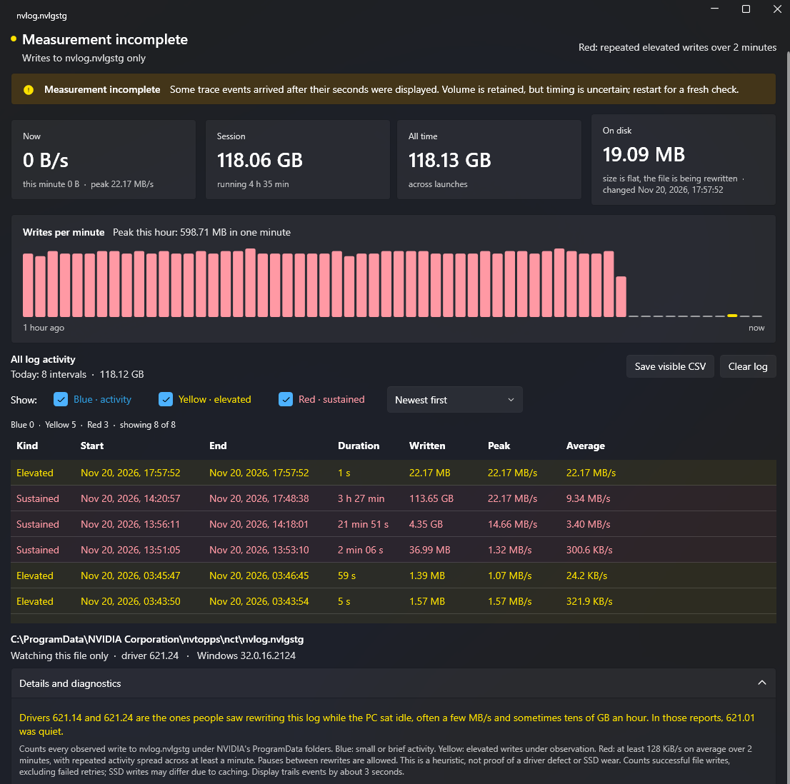

# nvlog.nvlgstg detector

Windows x64 detector for excessive writes to `nvlog.nvlgstg` in NVIDIA's ProgramData folders.
It observes writes; it does not change drivers, services, registry settings, or log permissions.

**Experimental:** this is a file-write monitor with heuristic alerts, not an official NVIDIA diagnostic or an SSD-health tool. An incomplete-measurement warning means the result cannot establish that the file is quiet.



The session counter in this capture shows 118.06 GB over 4 h 35 min while the log occupies 19.09 MB. These are logical file writes, not measured SSD/NAND writes. The late-event warning means some event timing is uncertain.

## Download and run

[Download the latest Windows x64 release](https://github.com/applejuicy23/nvlog.nvlgstg-detector/releases/latest).

Download the Windows x64 ZIP from this repository's **Releases** section, extract the entire archive, and run `NvlogDetector.exe` as administrator. No separate .NET installation is needed for the self-contained release. Keep the DLLs and other files next to the EXE. Close an older instance before starting an update.

If no release is available yet, build from source using the instructions below.

## Privacy and permissions

The application makes no network requests. History and error logs are stored locally under `%LOCALAPPDATA%\nvlog.nvlgstg-detector`; CSV export happens only when requested. Administrator rights and `SeDebugPrivilege` are used to observe ETW events and identify the log file's open handles. The program does not alter NVIDIA files or fix the driver.

## What the indicators mean

- Yellow: elevated log writes; the pattern is still being observed. It does not mean the write was one-time.
- Blue: all other observed writes, including a single byte or a brief burst. Nearby writes are grouped into an interval that closes after five seconds with no writes. A blue interval can turn yellow or red without duplicating its bytes.
- Red: a 120-second window averages at least 128 KiB/s and contains activity in at least three separate 10-second buckets, spanning at least 60 seconds. Pauses between rewrites are allowed.
- Yellow/red intervals end after 75 seconds without writes. Every positive byte, including a low-rate tail, remains in the interval. A large isolated burst stays yellow.
- These thresholds are detection heuristics, not NVIDIA specifications or proof of a particular driver defect. Versions alone never establish whether a machine is affected.
- The volume is bytes reported by successful logical file-write completions, not measured SSD wear or NAND writes. Failed attempts (including Fast I/O retries) are excluded. Windows caching can change how much reaches storage.

ETW timestamps determine the per-second counts, even if the interface stalls. The display intentionally trails events by about three seconds to allow trace delivery. Remaining buffered volume is saved on normal exit. File size is displayed separately and is not used as a write counter.

Missing attribution, trace failures, lost events, late events, and unmatched write completions produce an incomplete-measurement warning. Lost events or unresolved operations mean recorded volume may be too low. Late-event volume is retained, but its timing is uncertain. Restart the application to begin a fresh measurement after these warnings.

Attribution can remain unverified until the file is opened or written while monitoring. Old entries in the journal are historical observations; they do not verify the current trace session. If the warning persists while Resource Monitor shows current writes to the log, report it as a detector issue rather than interpreting the zero counter as a clean result.

## Build and tests

The activity journal has independent Blue, Yellow, and Red checkboxes. The order selector supports newest first, blue-to-red, red-to-blue, and most bytes first. Column headers also sort; volume, peak, average, and duration use numeric values. `Save visible CSV` exports the selected colors in their displayed order. The graph and overall counters continue to include all measured writes.

The current journal retains the latest 1,000 closed intervals; all-time byte totals are retained separately. Historical low-level writes from versions that did not record blue intervals cannot be reconstructed.

Requires the .NET 10 SDK and Windows.

```powershell
dotnet build NvlogDetector.slnx -c Release
dotnet test tests/NvlogDetector.Tests/NvlogDetector.Tests.csproj -c Release
dotnet run --project tests/NvlogDetector.UiTests/NvlogDetector.UiTests.csproj -c Release
dotnet publish src/NvlogDetector/NvlogDetector.csproj -c Release -r win-x64 --self-contained true -o artifacts/win-x64
./scripts/package.ps1
```

Run the separate real-ETW check from an **administrator** PowerShell:

```powershell
dotnet run --project tests/NvlogDetector.EtwTests/NvlogDetector.EtwTests.csproj -c Release
```

This uses an isolated trace session and two temporary files. It checks exact byte counts for a file opened before monitoring, rejection of writes to a different file, detection after closing/reopening the target, and asynchronous writes. It writes about 7 MiB of test requests, without touching NVIDIA files or services. Exit code 0 means pass, 1 means failure, and 2 means the test was not run because elevation is missing. An optional single argument to the built test DLL specifies a text report path.

## Background

The reports concern repeated rewriting of a log that may stay small:

- [Comss: reports and an unaffected test system](https://www.comss.ru/page.php?id=22970)
- [Dell community: an earlier report with file-operation traces](https://www.dell.com/community/en/conversations/xps/excessive-nvidia-log-or-dump-nvlognvlgstg/6798edb55571a9437f10ad83)
- [Microsoft: file caching](https://learn.microsoft.com/en-us/windows/win32/fileio/file-caching)

The process-wide `WriteTransferCount` command in the Comss article includes other writes by the process. It is a cross-check, not the same counter as this application's file-specific volume.

## Contributing and license

Bug reports and pull requests are welcome. Include the detector version, Windows version, GPU/driver version, reproduction steps, and relevant Diagnostics output. Remove private information before posting. A bug-report template is available in Issues.

MIT — see [LICENSE](LICENSE). Dependencies retain their own licenses; see [third-party notices](THIRD-PARTY-NOTICES.md). This project is not affiliated with NVIDIA.
